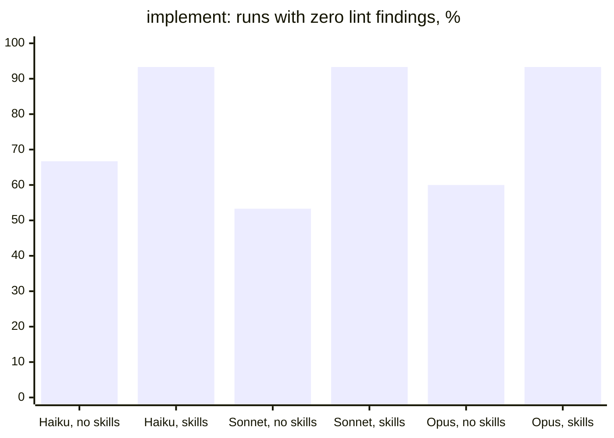
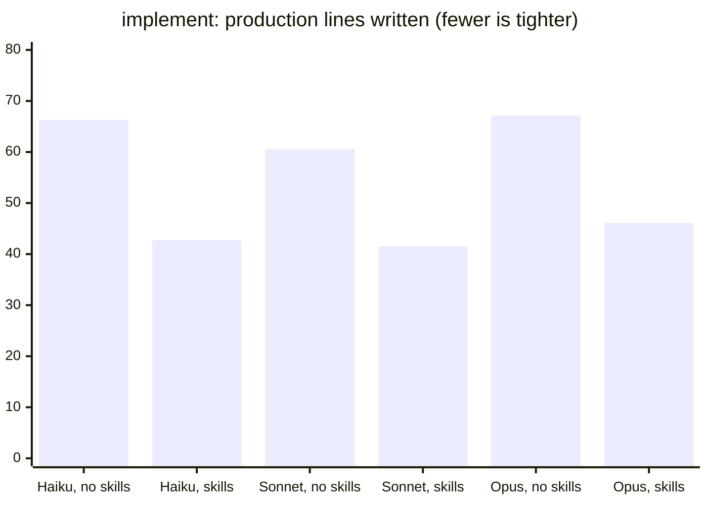
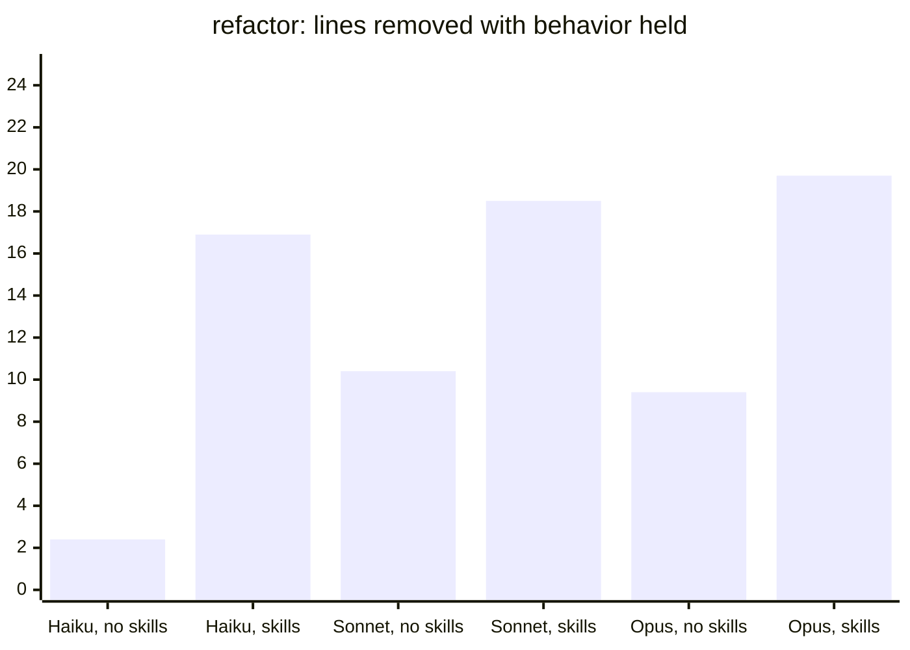
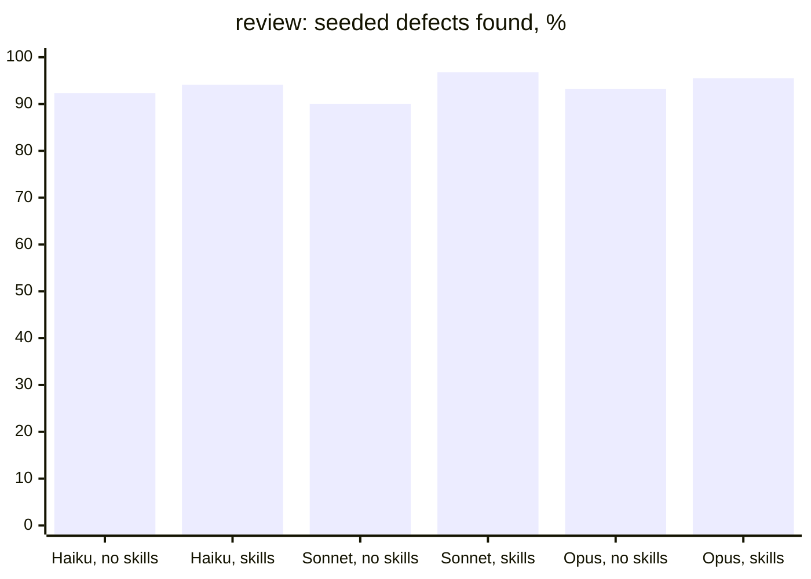
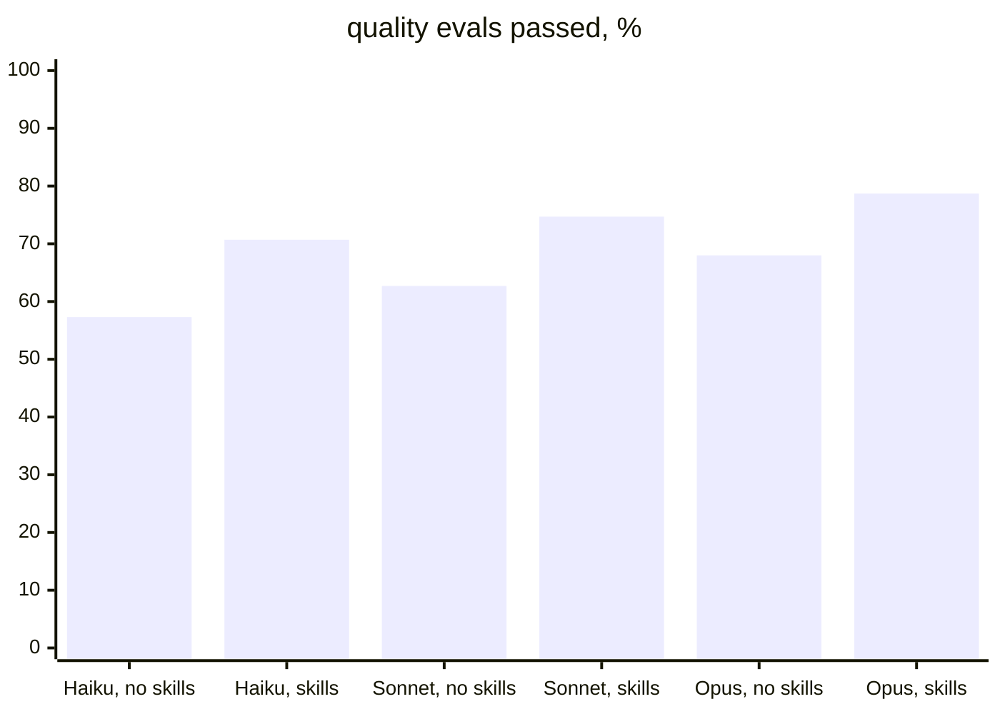
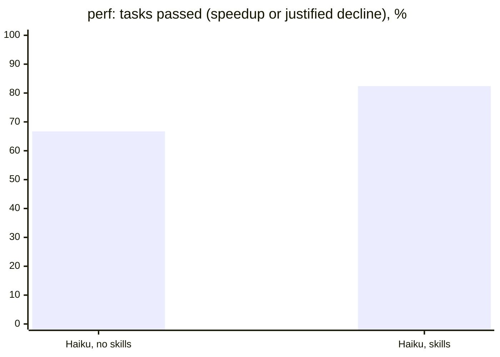

# Agent Skills For Go

**English** | [Українська](README.uk.md)

AI [Agent Skills](https://agentskills.io/) for writing idiomatic,
production-quality Go 1.27 code. The pack contains **24 modular skills**,
**73 reference files**, **11 bundled scripts**, and **5 asset templates**.
The Claude Code plugin also ships a `go-verify` agent and hooks for routing and
post-edit verification.

The guidance is derived from the [Google Go Style Guide](https://google.github.io/styleguide/go/),
[Effective Go](https://go.dev/doc/effective_go), the [Uber Go Style Guide](https://github.com/uber-go/guide/blob/master/style.md),
and [Go Wiki CodeReviewComments](https://github.com/golang/go/wiki/CodeReviewComments).

## Skills Included

The pack covers routing, refactoring, review, HTTP, databases, security,
resilience, troubleshooting, style, naming, errors, testing, concurrency,
generics, logging, documentation, performance, and package organization.
The current skill names are the directories under `skills/go-*/`.

## Bundled Scripts

**11 scripts automate** common checks. They support `--help`, structured
`--json` output, and documented exit codes; analysis scripts also support
`--limit`, and file-writing scripts require `--force`.

The plugin includes `agents/go-verify.md`, routing hooks under `hooks/`, and
the manifests under `.claude-plugin/`. In a Go project the hooks print the
restraint ladder at session start and into each subagent except `go-verify`
and the host's Explore, claude-code-guide, and statusline-setup; `/go-code ultra
<task>` or `lite mode` changes its level for the session, and
`GOLANG_SKILLS_LADDER=lite|ultra` sets the level a session starts at, and `off`
turns it off.

## Installation

### npx skills

```bash
npx skills add h0rn3t/golang-skills --all
```

### bun

`bunx` runs the same CLI without installing it, or install it once globally
(`bun add -g skills` puts it on `PATH` as `skills`):

```bash
# run without installing
bunx skills add h0rn3t/golang-skills --all

# or install the CLI once and reuse it
bun add -g skills
skills add h0rn3t/golang-skills --all
```

Updates work the same way: `bunx skills update` (add `-g` for the global
scope).

### Codex, Copilot, and Cursor

The same CLI installs into any agent it detects; name the targets with `-a`
when several are installed. All three read the project's `.agents/skills/`
directory, and `-g` installs for the user instead:

```bash
bunx skills add h0rn3t/golang-skills --all -a codex -a github-copilot -a cursor -g
```

| Agent | `--agent` | Global path |
| --- | --- | --- |
| Codex | `codex` | `~/.codex/skills/` |
| GitHub Copilot | `github-copilot` | `~/.copilot/skills/` |
| Cursor | `cursor` | `~/.cursor/skills/` |

Start a new session in the agent after installing.

### Claude Code plugin

```text
/plugin marketplace add h0rn3t/golang-skills
/plugin install golang-skills@golang-skills
```

### Manual installation

Copy the complete skill directories, including their `references/`, `scripts/`,
and `assets/` subdirectories:

```bash
cp -R skills/go-* ~/.claude/skills/
```

## Updating

### Claude Code

Refresh the marketplace snapshot, update the plugin, then restart Claude Code
to load the new version:

```bash
claude plugin marketplace update golang-skills
claude plugin update golang-skills@golang-skills
claude plugin list   # shows the installed version
```

### Codex, Copilot, and Cursor

Update the global install, then start a new session in the agent:

```bash
bunx skills update -g
```

Re-running `bunx skills add h0rn3t/golang-skills --all -g` also works and picks
up skills added since the last install.

### Manual installation

Pull the checkout and replace the skill directories rather than copying over
them, so files removed upstream do not linger:

```bash
git pull
rm -rf ~/.claude/skills/go-* && cp -R skills/go-* ~/.claude/skills/
```

For Codex, use `~/.codex/skills/` (the global path in the table above) or the project's `.agents/skills/` as the target directory.

## Project Instructions

A skill loads when the host's matcher or the model picks it. For a work
project where every Go edit must start from the router, paste the short block
from [`docs/PROJECT_INSTRUCTIONS.md`](docs/PROJECT_INSTRUCTIONS.md) into its
`CLAUDE.md` or `AGENTS.md`: router first, then `go-style-core` with its
idiom card, then only the owner skills the task needs. Under the Claude
Code plugin the routing gate also holds each `.go` edit made through Edit,
Write, or MultiEdit until those loads are recorded; a shell edit (`sed -i`,
`gofmt -w`) is not held, and without `go` on PATH the gate is off and says
so once per session (`GOLANG_SKILLS_ROUTING_GATE=off` turns it off). The
hooks need nothing beyond bash and Go: their parser is a small
standard-library program in `hooks/helper`, built on first use into the user
cache directory. Skills installed with
`npx skills` or copied get no hooks, so the instruction is all there is; a host
that loads the plugin's `hooks/hooks.json` (Codex) runs the hooks with the
routing gate off.

After each `.go` edit the post-edit hook runs gofmt, `go vet`, `go fix -diff`,
the package's tests (`go test -short`), and golangci-lint with the
repository's own config, without asking: repository code runs (`TestMain`,
`init`). Review an untrusted change with `GOLANG_SKILLS_EDIT_TESTS=off` and
`GOLANG_SKILLS_EDIT_LINT=off`. A lint config that loads `custom:` plugins is
replaced by the bundled baseline.

## Validation

`evals/` contains the structural Go test suite, fixtures, golden tests, and
the optional `evalrun`/`abrun` harnesses. It contains **110 trigger evals** and
**75 quality evals**; `evalrun -kind quality -ids 65,66 -n 3 -no-skill` runs
chosen cases repeatedly without the plugin, the control a new case is checked
against, and `-go-doc` lets the sessions check an API with `go doc`. Model-driven eval output is local scratch data and is not
stored in this repository. The suite also checks every `SKILL.md` against
the Agent Skills specification (`TestStructure`), so the checks
need Go and no Node.js.

Run the repository checks with:

```bash
(cd evals && go test -count=1 -race -shuffle=on ./...)
bash -n hooks/*.sh
golangci-lint config verify --config skills/go-linting/assets/golangci.yml
```

The release validation set is documented in
[`docs/RELEASE_CHECKLIST.md`](docs/RELEASE_CHECKLIST.md).

`plugin-evals/` holds cases for `claude plugin eval`, which loads the plugin
in a sandboxed `claude -p` session and compares runs with and without it.
They cost tokens and are opt-in; see
[`plugin-evals/README.md`](plugin-evals/README.md).

## Benchmarks

`abrun` measures what a skill does to the code a model writes, not what it says
about it. Each fixture ships documented but unimplemented declarations plus a
hidden golden test; the session edits real files in a scratch module and the
harness scores the result. Two arms answer one question: `baseline` loads this
skill tree from an isolated `HOME`, and `no-skill` loads an empty one, so the
delta is the skills and nothing else.

### Claude Code: Haiku, Sonnet, and Opus 5.5

The 2026-10-27 runs drove every corpus and both eval sets through Claude Code
2.1.311 at `--effort medium` on plugin 1.45.0. `abrun` ran two repetitions of
each fixture in both arms: 15 implement, 5 refactor, 11 review, and 9 perf
fixtures, perf with `-shell go`. `evalrun` ran the 110 trigger and 75 quality
cases once, and the quality cases again with `-no-skill`. Each chart pairs one
model without and with the skills.

Golden tests pass 97–100% in both arms, so on these fixtures the skills do
not change whether the code works; they change its shape. With the skills
every model writes lint-clean implementations in 93% of runs (53–67%
without), about 30% fewer production lines, and refactors that remove 17–20
lines where an unaided session removes 2–10. Review recall rises 2–7 points
from a 90–93% base, and quality evals 10–13 points. Trigger evals pass at
62% (Haiku), 76% (Sonnet), and 75% (Opus). A session with the skills costs
2–7× one without, mostly the loaded skill text written to the prompt cache.
Perf is so far measured on Haiku only; Sonnet (medium) and Opus (low effort)
are still running.













| Model | Corpus | Golden / pass | Lint clean | $/run |
|---|---|---|---|---|
| Haiku 5.5 | implement | 100.0% → 96.7% | 66.7% → 93.3% | 0.0045 → 0.0301 |
| Haiku 5.5 | refactor | 100.0% → 100.0% | 60.0% → 80.0% | 0.0039 → 0.0171 |
| Haiku 5.5 | review | 92.3% → 94.1% | — | 0.0058 → 0.0141 |
| Haiku 5.5 | perf | 66.7% → 82.4% | — | 0.01 → 0.0438 |
| Haiku 5.5 | quality evals | 57.3% → 70.7% | — | 0.002 → 0.0085 |
| Haiku 5.5 | trigger evals | — → 61.8% | — | — |
| Sonnet 5.5 | implement | 100.0% → 100.0% | 53.3% → 93.3% | 0.0478 → 0.2355 |
| Sonnet 5.5 | refactor | 100.0% → 100.0% | 40.0% → 80.0% | 0.0456 → 0.1977 |
| Sonnet 5.5 | review | 90.0% → 96.8% | — | 0.0705 → 0.1836 |
| Sonnet 5.5 | quality evals | 62.7% → 74.7% | — | 0.0226 → 0.1294 |
| Sonnet 5.5 | trigger evals | — → 76.4% | — | — |
| Opus 5.5 | implement | 96.7% → 100.0% | 60.0% → 93.3% | 0.1084 → 0.6364 |
| Opus 5.5 | refactor | 100.0% → 100.0% | 80.0% → 80.0% | 0.0976 → 0.4331 |
| Opus 5.5 | review | 93.2% → 95.5% | — | 0.1546 → 0.3525 |
| Opus 5.5 | quality evals | 68.0% → 78.7% | — | 0.0652 → 0.2599 |
| Opus 5.5 | trigger evals | — → 74.5% | — | — |

Golden and pass columns are golden tests passed for implement and refactor,
seeded defects found for review, and tasks passed for perf; $/run is the
session cost reported by the CLI. Regenerate with the same flags:

```bash
cd evals
go run ./cmd/abrun -corpus implement -arms no-skill,baseline -n 2 -j 3 \
  -effort medium -model claude-sonnet-5-5 -out implement.json
go run ./cmd/evalrun -set all -kind all -model claude-sonnet-5-5 -out evals.json
go run ./cmd/evalrun -set all -kind quality -no-skill -model claude-sonnet-5-5 -out control.json
```

The 2026-10-24 runs below drove the corpus through the opencode CLI, which
serves both models from one provider. Every run built and passed its golden
test in both arms, so the difference is shape rather than correctness:

| Corpus | Model | Δlines baseline → no-skill | Lint clean | Golden | $/run baseline → no-skill |
|---|---|---|---|---|---|
| implement (12) | DeepSeek V4.1 Flash | 58.2 → 77.5 (−25%) | 32/36 → 23/36 | 36/36 → 36/36 | 0.0136 → 0.0068 |
| implement (12) | Muse Spark 1.3 | 52.7 → 76.0 (−31%) | 29/36 → 21/36 | 36/36 → 36/36 | 0.0075 → 0.0034 |

Δlines is the production line count the session left minus the stub package it
started from, so a smaller number is a tighter implementation of the same
contract. Lint clean counts runs with zero findings under the bundled
`golangci.yml`. Both runs used `-corpus implement -arms baseline,no-skill -n 3
-j 4`: 12 fixtures × 2 arms × 3 repetitions = 72 sessions each, on Go 1.27 and
opencode 2.1.1 with `--standalone`.

Read the `skill` column in a local report with care on this runner: opencode
does not emit the `skill` tool call that `abrun` counts, so trigger rate and
routing read as unmeasured there. These numbers compare a home that has the
skills with one that does not — they do not prove the model invoked a specific
skill. The Claude Code runner is the one that reports firings.

Reports are local scratch data; regenerate them with the same flags rather than
trusting a stored copy:

```bash
cd evals
go run ./cmd/abrun -corpus implement -runner opencode \
  -model opencode-go/muse-spark-1.3-contributor \
  -arms baseline,no-skill -n 3 -j 4 -out ab.json
```

## Project Structure

```text
skills/       Runtime skill directories.
hooks/        Claude Code routing and post-edit hooks.
agents/       Optional plugin agents.
evals/        Structural tests, fixtures, golden tests, and runners.
plugin-evals/ Cases for `claude plugin eval`.
source/       Upstream style-guide snapshots with provenance and licenses.
docs/         Authoring, ownership, script-contract, and release policy.
```

`COMPATIBILITY.md` is the source of truth for version-sensitive Go guidance.
`docs/RULE_OWNERSHIP.md` records which skill owns each rule, and
`docs/SCRIPT_JSON_CONTRACTS.md` defines the bundled script output contracts.

## Go 1.27

The skills target Go 1.27 and support Go 1.26 and 1.27. Verify version-sensitive
claims against the installed toolchain and update
[`COMPATIBILITY.md`](COMPATIBILITY.md) when the baseline changes.

## License

Project-authored files are Apache-2.0. Upstream snapshots and derived guidance
are listed in [`THIRD_PARTY_NOTICES.md`](THIRD_PARTY_NOTICES.md).
