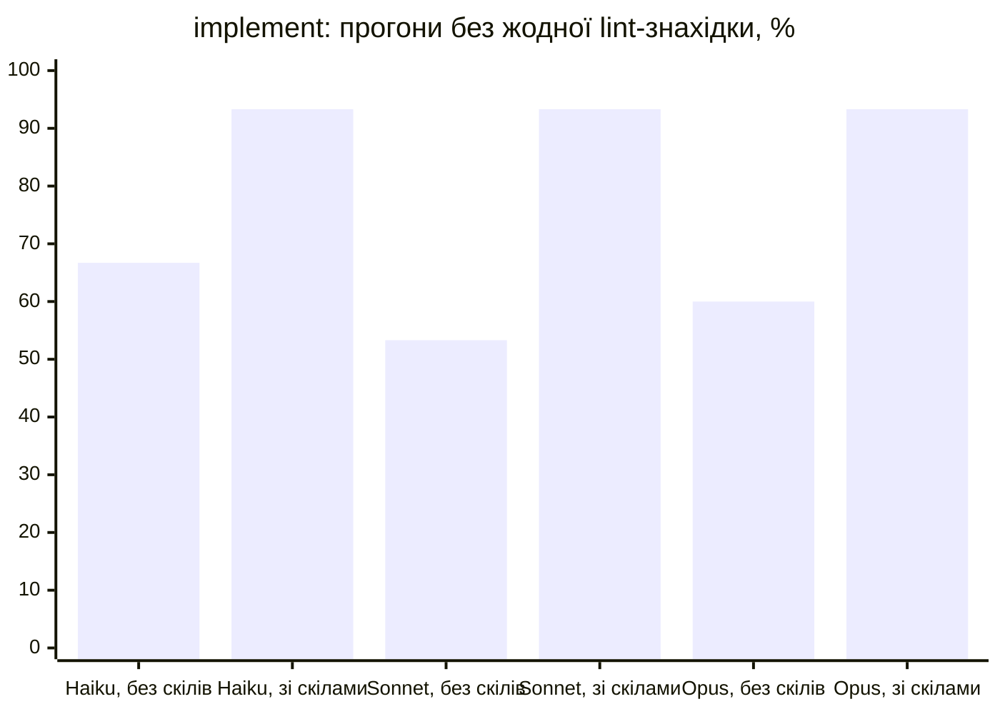
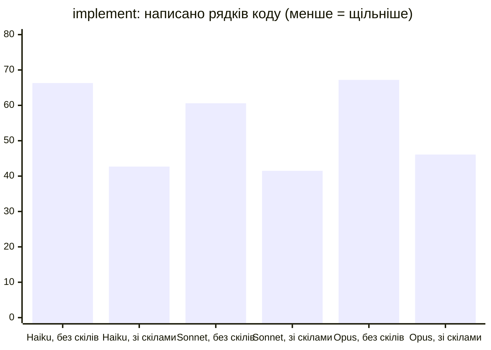
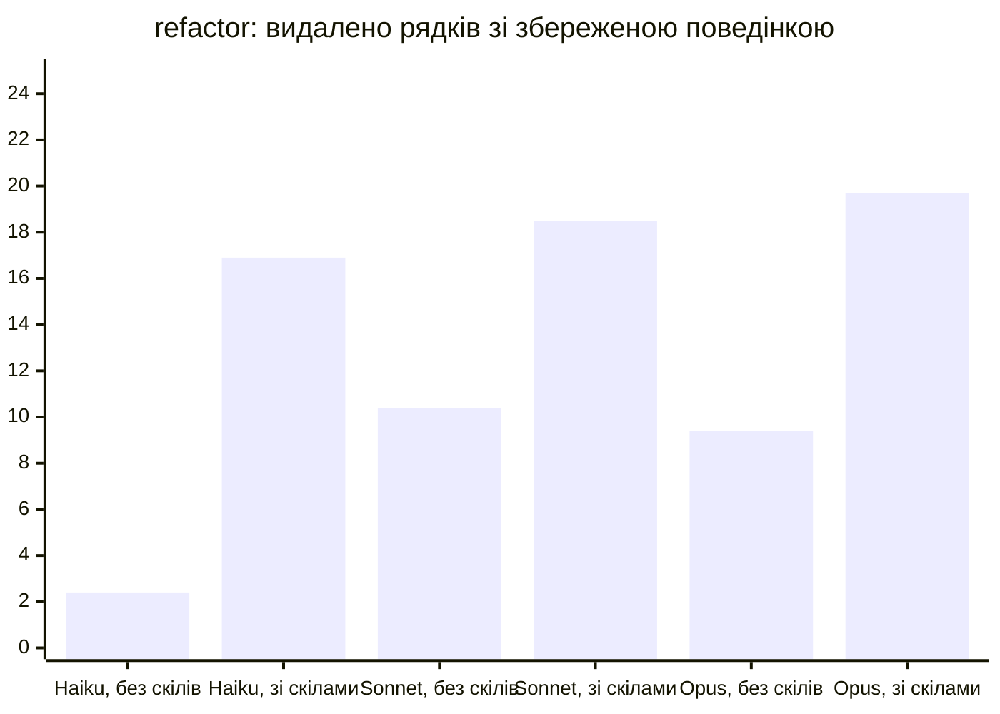
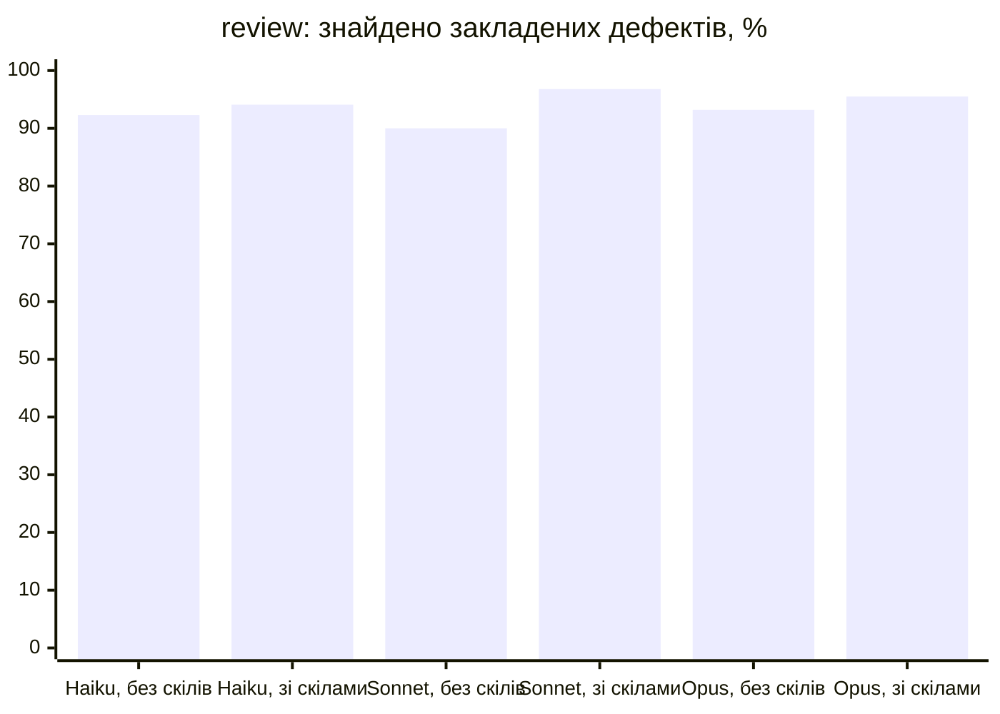
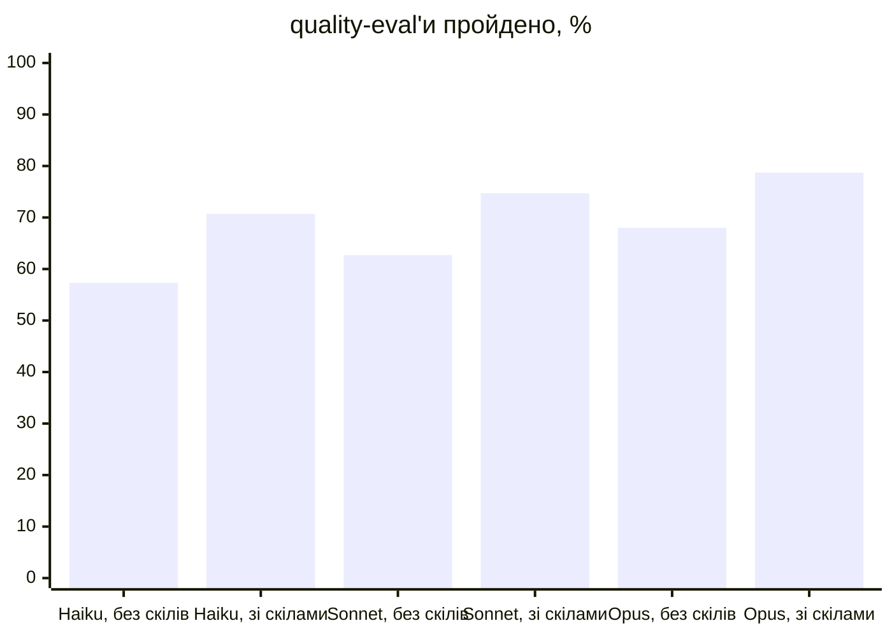
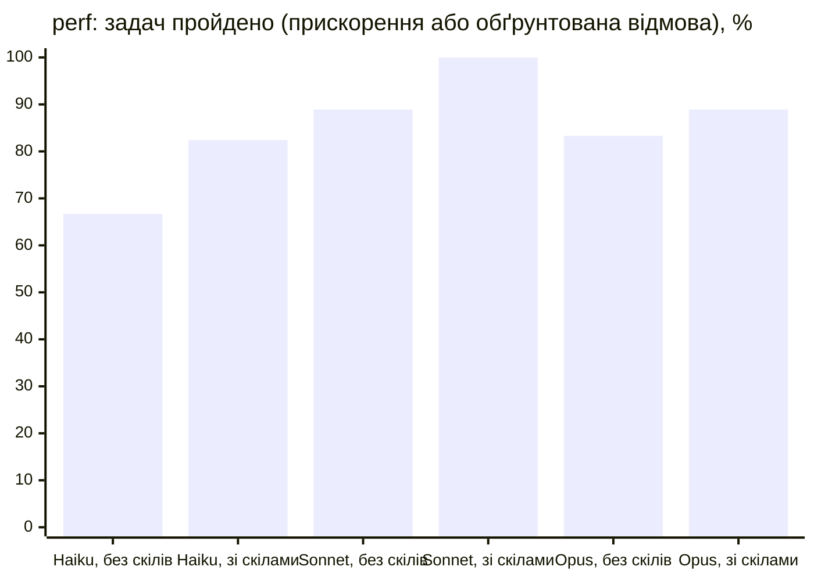

# Agent Skills для Go

**Українська** | [English](README.md)

Набір [Agent Skills](https://agentskills.io/) для ідіоматичного та
production-ready коду на Go 1.27. Пакет містить **24 модульних скіли**,
**73 довідкові файли**, **11 вбудованих скриптів** і **5 шаблонів-ассетів**.
Плагін Claude Code також містить агента `go-verify` та хуки маршрутизації й
перевірки після редагування.

Настанови походять із [Google Go Style Guide](https://google.github.io/styleguide/go/),
[Effective Go](https://go.dev/doc/effective_go), [Uber Go Style Guide](https://github.com/uber-go/guide/blob/master/style.md)
і [Go Wiki CodeReviewComments](https://github.com/golang/go/wiki/CodeReviewComments).

## Скіли

Пакет охоплює маршрутизацію, рефакторинг, рев'ю, HTTP, бази даних,
безпеку, стійкість, діагностику, стиль, імена, помилки, тестування,
конкурентність, generics, логування, документацію, продуктивність і структуру
пакетів. Актуальні назви — це директорії `skills/go-*/`.

## Вбудовані скрипти

**11 скриптів автоматизують** типові перевірки. Вони підтримують `--help`,
структурований вивід `--json` і задокументовані коди завершення; аналітичні
скрипти також мають `--limit`, а скрипти, що пишуть файли, вимагають `--force`.

Плагін містить `agents/go-verify.md`, хуки в `hooks/` і маніфести в
`.claude-plugin/`. У Go-проєкті хуки виводять драбину стриманості на старті
сесії та в кожного сабагента, крім `go-verify` і хостових Explore,
claude-code-guide та statusline-setup; `/go-code ultra <задача>` або `lite mode`
змінює її рівень до кінця сесії, `GOLANG_SKILLS_LADDER=lite|ultra` задає
рівень на старті сесії, а `off` вимикає її.

## Встановлення

### npx skills

```bash
npx skills add h0rn3t/golang-skills --all
```

### bun

`bunx` запускає той самий CLI без встановлення, або встановіть його один раз
глобально (`bun add -g skills` додає `skills` у `PATH`):

```bash
# запустити без встановлення
bunx skills add h0rn3t/golang-skills --all

# або встановити CLI один раз і користуватися ним
bun add -g skills
skills add h0rn3t/golang-skills --all
```

Оновлення працює так само: `bunx skills update` (додайте `-g` для глобальної
області).

### Codex, Copilot і Cursor

Той самий CLI встановлює скіли в кожен агент, який виявить; назвіть цілі
прапорцем `-a`, якщо встановлено кілька. Усі три читають проєктну директорію
`.agents/skills/`, а `-g` встановлює для користувача:

```bash
bunx skills add h0rn3t/golang-skills --all -a codex -a github-copilot -a cursor -g
```

| Агент | `--agent` | Глобальний шлях |
| --- | --- | --- |
| Codex | `codex` | `~/.codex/skills/` |
| GitHub Copilot | `github-copilot` | `~/.copilot/skills/` |
| Cursor | `cursor` | `~/.cursor/skills/` |

Після встановлення відкрийте нову сесію агента.

### Плагін Claude Code

```text
/plugin marketplace add h0rn3t/golang-skills
/plugin install golang-skills@golang-skills
```

### Ручне встановлення

Копіюйте повні директорії скілів разом із `references/`, `scripts/` і `assets/`:

```bash
cp -R skills/go-* ~/.claude/skills/
```

## Оновлення

### Claude Code

Оновіть знімок маркетплейсу, потім сам плагін і перезапустіть Claude Code, щоб
підхопити нову версію:

```bash
claude plugin marketplace update golang-skills
claude plugin update golang-skills@golang-skills
claude plugin list   # показує встановлену версію
```

### Codex, Copilot і Cursor

Оновіть глобальну інсталяцію і відкрийте нову сесію агента:

```bash
bunx skills update -g
```

Повторний `bunx skills add h0rn3t/golang-skills --all -g` теж працює і додає
скіли, що з'явилися після попереднього встановлення.

### Ручне встановлення

Оновіть checkout і замініть директорії скілів, а не копіюйте поверх них, щоб
видалені в апстрімі файли не залишалися:

```bash
git pull
rm -rf ~/.claude/skills/go-* && cp -R skills/go-* ~/.claude/skills/
```

Для Codex цільова директорія — `~/.codex/skills/` (глобальний шлях із таблиці вище) або `.agents/skills/` проєкту.

## Інструкції для проєкту

Скіл завантажується, коли його обирає matcher хоста або модель. Для робочого
проєкту, де кожна правка Go має починатися з router, вставте короткий блок із
[`docs/PROJECT_INSTRUCTIONS.md`](docs/PROJECT_INSTRUCTIONS.md) у його
`CLAUDE.md` або `AGENTS.md`: спершу router, потім `go-style-core` з його
карткою ідіом, потім лише ті owner-скіли, які потрібні задачі. У плагіні
Claude Code routing gate до того ж тримає кожну правку `.go` через Edit,
Write або MultiEdit, доки ці завантаження не зафіксовано; правку з shell
(`sed -i`, `gofmt -w`) він не тримає, а без `go` у PATH вимкнений і раз за
сесію про це повідомляє (`GOLANG_SKILLS_ROUTING_GATE=off` його вимикає). Хукам
не потрібно нічого, крім bash і Go: їхній парсер — невелика програма на
стандартній бібліотеці в `hooks/helper`, що збирається при першому запуску в
кеш-каталог користувача. Скіли, встановлені через
`npx skills` або скопійовані, хуків не мають, тож там працює лише інструкція;
хост, що завантажує `hooks/hooks.json` плагіна (Codex), запускає хуки з
вимкненим routing gate.

Після кожної правки `.go` post-edit хук без запиту запускає gofmt, `go vet`,
`go fix -diff`, тести пакета (`go test -short`) і golangci-lint з конфігом
репозиторію: виконується код репозиторію (`TestMain`, `init`). Неперевірену
зміну переглядайте з `GOLANG_SKILLS_EDIT_TESTS=off` і
`GOLANG_SKILLS_EDIT_LINT=off`. Конфіг лінтера, що завантажує плагіни
`custom:`, хук замінює бандловим baseline.

## Перевірка

`evals/` містить структурні Go-тести, fixtures, golden-тести та опційні
раннери `evalrun`/`abrun`. У конфігурації є **110 eval'ів на тригери** і
**75 eval'ів на якість**; `evalrun -kind quality -ids 65,66 -n 3 -no-skill`
повторює вибрані кейси без плагіна — це контроль, з яким звіряють новий кейс;
`-go-doc` дозволяє сесіям перевірити API через `go doc`.
Результати модельних прогонів — локальні тимчасові
артефакти й не зберігаються в репозиторії. Набір також перевіряє кожен
`SKILL.md` на відповідність специфікації Agent Skills
(`TestStructure`), тож для перевірок потрібен Go, а Node.js — ні.

Основні перевірки:

```bash
(cd evals && go test -count=1 -race -shuffle=on ./...)
bash -n hooks/*.sh
golangci-lint config verify --config skills/go-linting/assets/golangci.yml
```

Набір release-перевірок описаний у
[`docs/RELEASE_CHECKLIST.md`](docs/RELEASE_CHECKLIST.md).

`plugin-evals/` містить кейси для `claude plugin eval`: він завантажує плагін
в ізольованій сесії `claude -p` і порівнює прогони з плагіном і без нього.
Прогони витрачають токени й запускаються лише вручну; деталі в
[`plugin-evals/README.md`](plugin-evals/README.md).

## Бенчмарки

`abrun` міряє, що скіл робить із кодом, який модель пише, а не що вона про
нього говорить. Кожен fixture містить задокументовані, але нереалізовані
декларації та прихований golden-тест; сесія редагує справжні файли в
тимчасовому модулі, і harness оцінює результат. Дві arms відповідають на одне
питання: `baseline` завантажує це дерево скілів з ізольованого `HOME`, а
`no-skill` — порожній, тож різниця — це скіли і більше нічого.

### Claude Code: Haiku, Sonnet і Opus 5.5

Прогони 2026-10-27 провели всі corpus і обидва набори eval'ів через Claude
Code 2.1.311 з `--effort medium` на плагіні 1.45.0. `abrun` виконав по два
повтори кожного fixture в обох arms: 15 implement, 5 refactor, 11 review і 9
perf, perf з `-shell go`. `evalrun` прогнав 110 trigger- і 75 quality-кейсів
один раз, а quality-кейси ще раз із `-no-skill`. Кожен графік ставить поруч
одну модель без скілів і зі скілами.

Golden-тести проходять у 97–100% в обох arms, тож на цих fixtures скіли не
змінюють того, чи працює код, — вони змінюють його форму. Зі скілами кожна
модель пише реалізацію без lint-знахідок у 93% прогонів (без скілів 53–67%),
приблизно на 30% менше рядків production-коду, а refactor видаляє 17–20
рядків там, де сесія без скілів видаляє 2–10. Recall у review зростає на 2–7
пунктів від бази 90–93%, quality-eval'и — на 10–13 пунктів. Trigger-eval'и
проходять на 62% (Haiku), 76% (Sonnet) і 75% (Opus). Сесія зі скілами коштує
у 2–7 разів більше, переважно через текст скілів, записаний у prompt cache.
Perf-задачі проходять на 67% → 82% (Haiku), 89% → 100% (Sonnet) і 83% → 89%
(Opus), а скіли частіше змушують сесію виміряти до правки (39–67% →
83–89%). Perf для Opus прогнано з `--effort low`; решта прогонів Opus —
medium.

#### Як проводилися прогони

Кожна сесія — headless-запуск `claude -p` з `--restricted`, тож налаштування,
hooks і встановлені плагіни оператора в неї не потрапляють. Arm `baseline`
отримує свіжу копію цього плагіна через `--plugin-dir` (скіли й hooks, тож
routing gate і перевірки після правки працюють так само, як у користувача);
arm `no-skill` не отримує ні плагіна, ні інструмента `Skill`. Обидві arms
бачать той самий fixture, prompt, модель і effort і працюють у тимчасовому
модулі, де є тільки пакет fixture. Сесії мають `Read`, `Glob`, `Grep`, `Edit`
і `Write` (review — лише читання) і не мають shell, крім perf, де `-shell go`
дозволяє Go toolchain, `golangci-lint` і скрипти плагіна.

- **implement** (15 fixtures): кожен пакет містить задокументовані декларації
  з тілами `panic("not implemented")`; prompt просить написати тіла, не
  змінюючи сигнатур. Після сесії harness перейменовує власні тести моделі на
  `*_test.go.model`, копіює прихований golden-тест, якого модель не бачила, і
  запускає його. *Без lint-знахідок* — прогін без жодної знахідки за
  `golangci.yml` плагіна; *написано рядків* — додані рядки production-коду.
- **refactor** (5 fixtures): робочі, але роздуті пакети; prompt просить
  refactor зі збереженням поведінки. Прихований characterization-тест фіксує
  exported API, тексти помилок і вивід; *видалено рядків* — рядки
  production-коду, які сесія прибрала, а тест лишився зеленим.
- **review** (11 fixtures): пакети із закладеними дефектами з прихованого
  ключа, плюс baits (правильний код, що виглядає неправильним). Сесія пише
  review з посиланнями `file.go:NN` і нічого не редагує; дефект знайдено,
  якщо знахідка вказує на його рядок, тож *знайдено* — це recall за ключем.
- **perf** (9 fixtures): задачі на прискорення і задачі, де треба відмовитися
  (код уже добрий або запит зламав би контракт). Harness бенчмаркає пакет до
  і після; задача на прискорення пройдена, коли golden-тест тримається,
  вердикт бенчмарку — *keep* з виграшем не менше мінімуму fixture і жоден bait
  не змінено; задача на відмову — коли поведінка та сама і ціль не зачеплено.
- **trigger-eval'и** (110 запитів): лише інструмент `Skill`, три ходи; кейс
  пройдено, коли спрацювали всі очікувані скіли, а негативний — коли не
  спрацював жоден Go-скіл.
- **quality-eval'и** (75 запитів): інструменти лише для читання і файли
  fixture; друга сесія Claude без плагіна оцінює відповідь за assertions
  кейсу, і кейс пройдено лише тоді, коли пройдено всі. Стовпчики `no-skill`
  повторюють ті самі кейси без плагіна.

Обмеження: двох повторів на fixture досить, щоб побачити великі розриви вище,
і замало для малих (recall у review, одиничний провал golden); fixtures
написані цим проєктом, тож скіл можна під них підігнати; вартість — це
`total_cost_usd` самого CLI. Сесія, яку CLI завершив власною помилкою (ліміт
використання), — це помилка прогону: її не оцінюють, а відкидають.













| Модель | Корпус | Golden / pass | Lint clean | $/прогін |
|---|---|---|---|---|
| Haiku 5.5 | implement | 100.0% → 96.7% | 66.7% → 93.3% | 0.0045 → 0.0301 |
| Haiku 5.5 | refactor | 100.0% → 100.0% | 60.0% → 80.0% | 0.0039 → 0.0171 |
| Haiku 5.5 | review | 92.3% → 94.1% | — | 0.0058 → 0.0141 |
| Haiku 5.5 | perf | 66.7% → 82.4% | — | 0.01 → 0.0438 |
| Haiku 5.5 | quality evals | 57.3% → 70.7% | — | 0.002 → 0.0085 |
| Haiku 5.5 | trigger evals | — → 61.8% | — | — |
| Sonnet 5.5 | implement | 100.0% → 100.0% | 53.3% → 93.3% | 0.0478 → 0.2355 |
| Sonnet 5.5 | refactor | 100.0% → 100.0% | 40.0% → 80.0% | 0.0456 → 0.1977 |
| Sonnet 5.5 | review | 90.0% → 96.8% | — | 0.0705 → 0.1836 |
| Sonnet 5.5 | perf | 88.9% → 100.0% | — | 0.0785 → 0.4048 |
| Sonnet 5.5 | quality evals | 62.7% → 74.7% | — | 0.0226 → 0.1294 |
| Sonnet 5.5 | trigger evals | — → 76.4% | — | — |
| Opus 5.5 | implement | 96.7% → 100.0% | 60.0% → 93.3% | 0.1084 → 0.6364 |
| Opus 5.5 | refactor | 100.0% → 100.0% | 80.0% → 80.0% | 0.0976 → 0.4331 |
| Opus 5.5 | review | 93.2% → 95.5% | — | 0.1546 → 0.3525 |
| Opus 5.5 | perf | 83.3% → 88.9% | — | 0.1619 → 0.7344 |
| Opus 5.5 | quality evals | 68.0% → 78.7% | — | 0.0652 → 0.2599 |
| Opus 5.5 | trigger evals | — → 74.5% | — | — |

Колонка golden / pass — це пройдені golden-тести для implement і refactor,
знайдені закладені дефекти для review і пройдені задачі для perf; $/прогін —
вартість сесії, яку повідомляє CLI. Відтворити з тими самими прапорцями:

```bash
cd evals
go run ./cmd/abrun -corpus implement -arms no-skill,baseline -n 2 -j 3 \
  -effort medium -model claude-sonnet-5-5 -out implement.json
go run ./cmd/evalrun -set all -kind all -model claude-sonnet-5-5 -out evals.json
go run ./cmd/evalrun -set all -kind quality -no-skill -model claude-sonnet-5-5 -out control.json
```

Прогони 2026-10-24 нижче виконували corpus через CLI opencode, який віддає
обидві моделі з одного провайдера. Усі прогони зібралися й пройшли свій
golden-тест в обох arms, тож різниця — у формі, а не в коректності:

| Corpus | Модель | Δlines baseline → no-skill | Lint clean | Golden | $/run baseline → no-skill |
|---|---|---|---|---|---|
| implement (12) | DeepSeek V4.1 Flash | 58.2 → 77.5 (−25%) | 32/36 → 23/36 | 36/36 → 36/36 | 0.0136 → 0.0068 |
| implement (12) | Muse Spark 1.3 | 52.7 → 76.0 (−31%) | 29/36 → 21/36 | 36/36 → 36/36 | 0.0075 → 0.0034 |

Δlines — це кількість production-рядків, які сесія залишила, мінус stub-пакет,
з якого вона стартувала, тому менше число означає щільнішу реалізацію того
самого контракту. Lint clean рахує прогони без findings під бандловим
`golangci.yml`. Обидва прогони використовували `-corpus implement -arms
baseline,no-skill -n 3 -j 4`: 12 fixtures × 2 arms × 3 повтори = 72 сесії
кожен, на Go 1.27 і opencode 2.1.1 з `--standalone`.

Колонку `skill` у локальному звіті на цьому раннері читайте обережно:
opencode не емітить виклик `skill`, який рахує `abrun`, тож trigger rate і
routing там незмірені. Ці числа порівнюють home зі скілами і home без них —
вони не доводять, що модель викликала конкретний скіл. Виклики скілів
звітує раннер Claude Code.

Звіти — локальні тимчасові артефакти; відтворюйте їх тими самими флагами,
а не покладайтеся на збережену копію:

```bash
cd evals
go run ./cmd/abrun -corpus implement -runner opencode \
  -model opencode-go/muse-spark-1.3-contributor \
  -arms baseline,no-skill -n 3 -j 4 -out ab.json
```

## Структура проєкту

```text
skills/       Директорії runtime-скілів.
hooks/        Хуки маршрутизації та перевірки після редагування.
agents/       Опційні агенти плагіна.
evals/        Структурні тести, fixtures, golden-тести та раннери.
plugin-evals/ Кейси для `claude plugin eval`.
source/       Знімки upstream-настанов із provenance і ліцензіями.
docs/         Політика авторингу, власності правил, скриптів і release.
```

`COMPATIBILITY.md` — джерело правди для версієзалежних настанов Go.
`docs/RULE_OWNERSHIP.md` фіксує власника кожного правила, а
`docs/SCRIPT_JSON_CONTRACTS.md` — контракти виводу скриптів.

## Go 1.27

Скіли орієнтовані на Go 1.27 і підтримують Go 1.26 та 1.27. Перевіряйте
версієзалежні твердження встановленим toolchain і оновлюйте
[`COMPATIBILITY.md`](COMPATIBILITY.md) при зміні baseline.

## Ліцензія

Файли, написані для проєкту, мають ліцензію Apache-2.0. Upstream-знімки та
похідні настанови перелічені в
[`THIRD_PARTY_NOTICES.md`](THIRD_PARTY_NOTICES.md).
